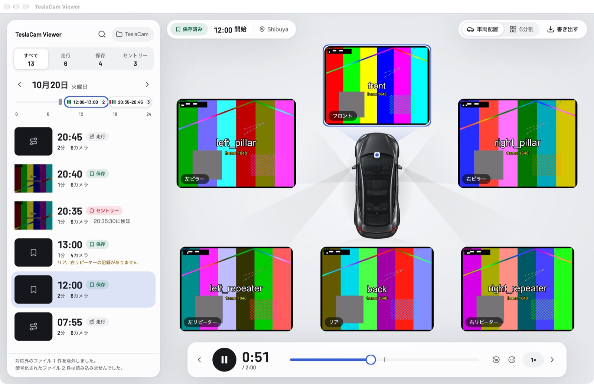
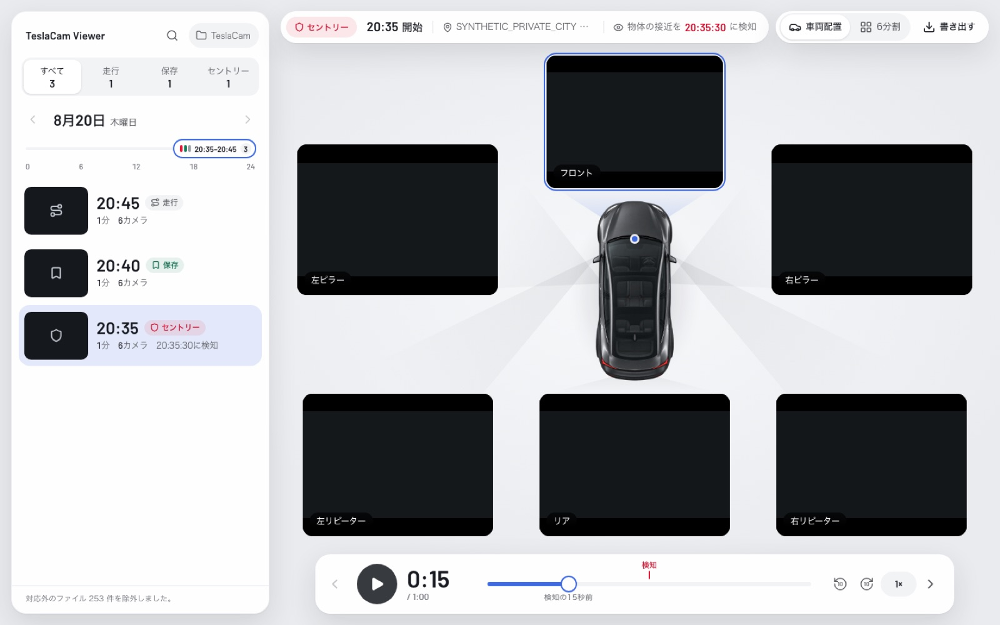

# TeslaCam Viewer

Find a moment on your Tesla's dashcam drive and watch all six cameras at once, in sync, around the car.
Everything runs on your own machine: no footage, file names, times or locations leave it.

Two apps share one design system and one domain contract:

| App | Where | Stack |
|---|---|---|
| Web | [teslacam.2-38.com](https://teslacam.2-38.com) — Chrome or Edge on a Mac | React 19, Vite, WebCodecs, File System Access API, Cloudflare Workers (static assets) |
| Mac | [Releases](https://github.com/kandotrun/teslacam-viewer/releases) — macOS 14+ | Rust, [GPUI Kit](https://gpui-kit.com/), AVFoundation / VideoToolbox |

*The Mac app on test footage. Every camera shows the same burned-in frame number (`frame 1848`) while playing.*

## Repository layout

| Path | What it is |
|---|---|
| `apps/web` | The web app (see `apps/web/package.json`) |
| `apps/mac` | The Mac app: `teslacam-core` (domain rules, pure state machines), `teslacam-media` (six synced `AVPlayer`s, composite export), `teslacam-app` (GPUI Kit UI). See [`apps/mac/README.md`](apps/mac/README.md). |
| `packages/contract` | Shared contract: design tokens, the 1280 × 720 export frame, and golden fixtures generated from the web's domain functions that the Rust core is tested against |
| `packages/assets` | Barlow (OFL), shared by both apps |
| `DESIGN.md` | The "garage floor" design system for both apps |
| `docs/specs` | The Mac parity specification |

Tasks live in the root `justfile`: `just web-check`, `just web-e2e`, `just mac-test`, `just mac-run`,
`just contract-check`, and more (`just --list`).

## Performance

All numbers were measured on one Apple M4 Max (16 cores, 128 GB) with Chrome 155 and synthetic
TeslaCam-like footage (H.264, 1280 × 960 at 36 fps, like HW3 cars), on the internal APFS SSD with a
warm page cache. A real USB drive formatted as exFAT is slower per file, so folder-scan times on a real
drive will be higher for both apps. Some runs shared the machine with other work; ranges are given where
that mattered.

### Mac app vs web app

| | Web, before the 2026-10 rewrite | Web, now | Mac app |
|---|---|---|---|
| Open a folder of ~100,000 files | ~56 s (browser enumeration 18.7 s + first file-size reads 34.8 s + library 2.7 s) | library step 1.96 s → 0.19 s; walk no longer waits per file (not re-timed on a real drive) | **0.33 s** (96,120 files, 1,441 `event.json`, median of 5) |
| Camera-to-camera sync while playing | corrected from `timeupdate` (~3.75 Hz) once drift exceeds 0.25 s, so cameras could be up to ~0.25–0.5 s apart | same mechanism | **0 frames** apart at 0.5×–4×, after seeks and across 60 s segment boundaries |
| Expanding one camera | reloaded all six videos (15–55 ms of black) | no reload | no reload |
| CPU while playing six cameras | not measured | not measured | 3.7–9.1 % of one core; 0 % paused |
| Composite export of a 120 s event (1280 × 720 MP4) | WebCodecs ≈ 264 fps (≈ 14 s), on in-memory files | same path, overlay drawn once (+3–7 %) | **7.0–7.9 s** (≈ 490 fps, 15–17× real time); 19–26 s with `AVAssetExportSession` before |

How the Mac app gets there: it walks the folder with plain `std::fs` and reads `event.json` files in
parallel; VideoToolbox decodes in hardware and GPUI draws the decoded `IOSurface` frames directly
(no copies); six `AVPlayer`s share one host clock and start together with `setRate:time:atHostTime:`
after an exact seek. For comparison, six independently started players drifted up to 3,851 frames apart
after seeks. The export decodes every camera with its own `AVAssetReader`, so the six hardware decoders
run in parallel, composes each frame with Core Image on the GPU and encodes it with the hardware H.264
encoder through `AVAssetWriter`, all on worker threads.

### What made the Mac export faster

Release build, the 120 s six-camera fixture event, three runs alternating with the previous pipeline so
both saw the same machine load (load average 37–47, the GPU shared with other apps):

| Change | Before | After |
|---|---|---|
| `AVAssetExportSession` (video composition + Core Animation overlay) → six `AVAssetReader`s, Core Image, `AVAssetWriter` | 22.5–27.4 s (median 24.6 s) | 7.0–7.9 s (median 7.4 s) |
| Wait for each Core Image render → keep three frames on the GPU; run the export threads as user-initiated work | 8.1–21.3 s, depending on what else used the GPU | 7.0–7.9 s |
| Decoding the six cameras alone (the floor of this pipeline) | — | 6.0 s |

The static overlay (floor, rounded holes, wedges, car, labels) is still drawn once per export: in the
first spike, redrawing the labels for every frame (`CATextLayer`) cut the export to 1.5× real time.
Scaling the video in the decoder instead of on the GPU did not help, because decoding is the limit.

### What made the web app faster (Chrome 155)

| Change | Before | After |
|---|---|---|
| Yield with `scheduler.yield()` instead of `setTimeout(0)` every 250 entries (Chrome clamps nested timers to ~4.4 ms) — library of 100k entries | 1,957 ms | ~187 ms |
| Same, in a background tab (2,000 entries; Chrome throttles timers there to seconds) | 27.4 s | not re-measured; `scheduler.yield()` is not a timer |
| Read `event.json` files in parallel (1,573 files on disk) | 2,771 ms | 293 ms |
| Walk the folder without awaiting `getFile()` per entry (File System Access on an OPFS stand-in, 5,000 files) | 1,447 ms | 165 ms |
| Stop reloading six videos when a camera is expanded | 18 `load()` calls | 0 |

### Why not Rust + WebAssembly in the browser

We checked before deciding on a native app. Almost all of the browser's time goes to file I/O, the
browser's hardware video decoder and encoder, and GPU compositing, none of which WebAssembly can
speed up:

| Work | JavaScript / GPU | Rust → Wasm (SIMD) |
|---|---|---|
| Parse and group 100k file names | 65 ms (22.7 ms after a plain-JS rewrite) | 14.2 ms incl. marshalling — but this step is under 0.1 % of a real-disk scan |
| Composite six hardware-decoded frames into one 1280 × 720 frame and encode it | 2.58 ms/frame on the GPU canvas | 8.45 ms/frame — 3.3× slower, because reading the frames back from the GPU (`VideoFrame.copyTo`) alone costs ~5.9 ms |

The large wins came from fixing how the work is scheduled (web) and from talking to the hardware
directly (Mac).

### Reproducing

- Mac folder scan: `cargo run --release -p teslacam-core --example scan_bench -- <TeslaCam folder>`
  (from `apps/mac`).
- Mac sync and export: `just mac-fixtures && just mac-test` — the media crate's main-thread tests decode
  the burned-in frame counters and assert 0 frames of spread, and time the export (one test exports the
  same event with both pipelines and requires the new one to be at least 2× faster).
- Mac export comparison: `cargo run --release -p teslacam-media --example export_bench -- 3 full`
  (from `apps/mac`, after `just mac-fixtures`) alternates both pipelines and prints their medians.
- The web and WebAssembly benchmarks were one-off harnesses run during development and are not in this
  repository; their numbers are recorded here.

## Privacy

The web app reads the folder through the browser's file APIs and never uploads anything; its
Content-Security-Policy allows only same-origin requests, which the end-to-end tests check. The Mac app
makes no network requests.

## Development

- Web: Node 24+, `just web-install`, `just web-dev`, `just web-check`, `just web-e2e`.
- Mac: Rust 1.96+, Xcode command line tools (the Metal Toolchain is not needed), ffmpeg/ffprobe for the
  media tests; `just mac-fixtures`, `just mac-test`, `just mac-run`, `apps/mac/scripts/bundle.sh` builds
  an unsigned `TeslaCam Viewer.app`.
- Shared contract: change a domain rule in the web, run `just contract-generate`, and make the Rust core
  pass `just mac-test` again.
